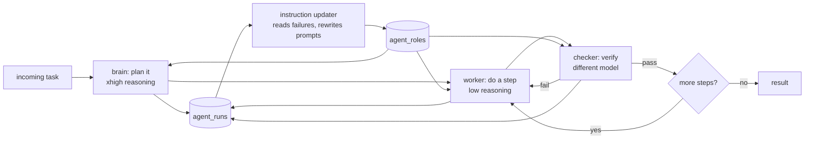

# Agent orchestration

Brains, workers, checkers and the agents that rewrite other agents' instructions — on one GPU.

Installed by [`../server/04-agents.sh`](../server/04-agents.sh).

## Start here: Kubernetes is not the orchestrator

The intuition that "an AI system orchestrated like Kubernetes" means *running the agents as Kubernetes workloads* is the one thing to unlearn. Kubernetes schedules containers onto nodes. It knows nothing about prompts, reasoning budgets or model routing, and on this machine it has exactly one GPU to allocate, whole, to one pod.

Three agent roles as three GPU pods means one runs and two sit `Pending` forever.

What you actually want from Kubernetes — restart on failure, declarative config, resource ceilings, one place to look — you get by running **n8n and the gateway** in the cluster. The agents themselves are rows in a database and nodes in a workflow.

| Concern | Handled by |
|---|---|
| Keeping the automation platform alive | k3s |
| Routing a call to a model, with a key and a budget | LiteLLM |
| Deciding which role runs next, and with what prompt | n8n |
| What each role is | a row in `agent_roles` in Postgres |
| Running the model | Strata or llama.cpp, on the host |

## The hard constraint

**One GPU serves one model at a time, and switching Strata packs costs 1–3 minutes.**

This single fact determines the entire design. A naive multi-role system — "brain uses the big model, workers use a fast model, checker uses a third" — would spend most of its wall-clock time loading weights. On a loop of twenty steps that is an hour of pure model swapping.

Two escapes, and the design uses both:

### 1. Roles are prompts, not models

The resident Strata pack serves both brain and worker, distinguished by **`reasoning_effort`** and system prompt:

| Role | Model | `reasoning_effort` | Why |
|---|---|---|---|
| `brain` | resident Strata pack | `xhigh` | Decomposition is where deep reasoning pays |
| `worker` | the same pack | `low` | Executing a decided plan does not need to re-derive it |

No swap, because it is the same loaded model. This is the single biggest performance decision in the agent system, and it costs nothing.

### 2. The checker is a genuinely different model, held in VRAM

A validator that shares a model with the worker shares its blind spots. If the worker hallucinated an API that does not exist, the same weights asked "is this correct?" will frequently agree.

So `checker` points at **llama.cpp holding a 7–14B GGUF entirely in VRAM** — a different architecture, different training data, independent failure modes. It costs ~9 GB of VRAM, which leaves Strata ~5 GB of hot-expert space instead of ~14, so Strata generates somewhat slower.

That is a real trade and worth being explicit about: **you are buying independent verification with Strata's throughput.** If you would rather have the speed, point `checker` at the `worker` alias and accept correlated errors. The config is one line in [`../server/k8s/11-litellm.yaml`](../server/k8s/11-litellm.yaml).



Note that the diagram has no parallelism in it. That is accurate — see below.

## "Parallel workers" means queued

LiteLLM is configured with `max_parallel_requests: 4`, and even that is optimistic. Strata's hybrid mode holds roughly 1.5 GB of KV cache per parallel slot at 32K context, and a 16 GB card supports about two slots at that length.

So a workflow that fans out to ten workers does not get ten workers. It gets a queue, and the total time is the sum rather than the maximum. Design around it:

- **Prefer fewer, larger worker calls** over many small ones. Per-call overhead is significant and concurrency will not hide it.
- **Batch independent items into a single prompt** where the model can handle it, rather than one call per item.
- **Use the checker sparingly.** Verifying every step doubles your call count. Verify the steps whose failure is expensive.

## The prompt store

Roles live in Postgres, not in workflow JSON, so a meta-agent can rewrite them and so you can see what changed.

```sql
CREATE TABLE agent_roles (
    name          TEXT PRIMARY KEY,     -- 'brain', 'worker', 'checker', ...
    model_alias   TEXT NOT NULL,        -- which LiteLLM alias to call
    system_prompt TEXT NOT NULL,
    temperature   REAL  DEFAULT 1.0,
    version       INT   DEFAULT 1,
    updated_at    TIMESTAMPTZ DEFAULT now(),
    updated_by    TEXT  DEFAULT 'human' -- 'human' or 'updater'
);

CREATE TABLE agent_role_history (     -- every version, never deleted
    id            BIGSERIAL PRIMARY KEY,
    name          TEXT NOT NULL,
    system_prompt TEXT NOT NULL,
    version       INT  NOT NULL,
    changed_at    TIMESTAMPTZ DEFAULT now(),
    changed_by    TEXT,
    rationale     TEXT                 -- why the updater thought this would help
);

CREATE TABLE agent_runs (
    id            BIGSERIAL PRIMARY KEY,
    task_id       TEXT,
    role          TEXT,
    role_version  INT,
    status        TEXT,                -- 'pass' | 'fail' | 'error'
    input         JSONB,
    output        JSONB,
    checker_notes TEXT,
    duration_ms   INT,
    created_at    TIMESTAMPTZ DEFAULT now()
);
```

`role_version` on every run is what makes the feedback loop measurable: you can ask whether version 4 of the worker prompt actually failed less often than version 3, rather than guessing.

## Sampling parameters are not optional

Thinking and instruct modes want genuinely different sampling, and a client that ignores this gets worse output than the model can produce:

| Mode | temperature | top_p | top_k | other |
|---|---|---|---|---|
| Thinking (`brain`) | 1.0 | 0.95 | 20 | — |
| Instruct (`worker` at low effort) | 0.7 | 0.80 | 20 | `presence_penalty: 1.5` |

`agent_roles.temperature` carries this per role. The seeded roles are already set correctly.

## The instruction updater

The meta-agent. It runs on a schedule rather than in the loop, because an agent that rewrites prompts mid-task makes failures impossible to attribute.

What it does:

1. Query `agent_runs` for failures since its last pass, grouped by role.
2. If a role's failure rate exceeds a threshold, pull the failing inputs, outputs and checker notes.
3. Ask `brain` to propose a revised system prompt, with a written rationale.
4. Write the proposal to `agent_role_history` — **not** to `agent_roles`.
5. Notify you.

**Step 4 is the important one.** The updater proposes; it does not deploy. An agent with write access to its own instructions and no gate is a system that can reason itself into any state at all, with no diff to review and no way back.

Promotion is a deliberate act:

```sh
agent-roles list                  # current versions and failure rates
agent-roles diff worker           # proposed change against live
agent-roles promote worker 5      # make version 5 live
agent-roles rollback worker       # back to the previous version
```

If you later decide to let it auto-promote, gate it on a measured improvement over a held-out set of tasks, not on the model's own confidence that the new prompt is better.

## Why n8n rather than a code framework

LangGraph, CrewAI and Temporal are all more powerful. n8n wins here on three specific points:

- **The topology is visible.** Agent systems fail in the routing, not the prompts, and a graph you can see beats a graph you have to reconstruct from stack traces.
- **It already has the integrations.** Webhooks, cron, email, Slack, HTTP, Postgres, and 400 more — the glue around the agents is most of the work and none of the interesting part.
- **Its own REST API makes meta-automation straightforward**, which is the "automated automations" piece.

Its weakness is real: complex conditional logic is more painful in a visual editor than in code. The escape hatch is the Code node, and the `pg` module is already allowed for exactly that.

If you outgrow it, the prompt store and the gateway are framework-agnostic — only the orchestration layer would need replacing.

## Automated automations

n8n's public API is enabled, so a workflow can read, create and modify other workflows:

```
GET    /api/v1/workflows           list
GET    /api/v1/workflows/{id}      fetch one, including its node graph
POST   /api/v1/workflows           create
PUT    /api/v1/workflows/{id}      replace
PATCH  /api/v1/workflows/{id}/activate
```

Create an API key under **Settings → n8n API**, store it as an n8n credential, and a workflow can then generate workflows — for example, a "new client onboarding" workflow that builds a per-client pipeline from a template.

Two cautions:

- **A workflow that can modify workflows can modify itself**, including disabling its own guard conditions. Keep the generator and the generated in separate projects, and never give the generator permission to `PUT` its own ID.
- **Generated workflows are not reviewed.** Have the generator create them **deactivated**, and activate by hand until you trust the pattern.

## Watching it work

```sh
agent-runs tail                   # live view of role calls as they happen
agent-runs stats                  # pass rate per role per version
agent-roles list

kubectl -n platform logs deploy/n8n --tail=50 -f
```

Spend is in the LiteLLM admin UI at `http://127.0.0.1:4000/ui`. It is measured in notional dollars against local models, which is meaningless in money and useful as a proxy for token volume.

## A realistic expectation

Multi-agent systems are oversold. On this hardware, with model swapping expensive and concurrency near zero, the honest summary is:

- **Brain-then-worker with one checker pass** is worth it for tasks with real decomposition, and measurably beats a single call.
- **Deep role hierarchies are not.** Each extra layer adds queue time and another chance to garble the task description.
- **The instruction updater earns its keep slowly**, over weeks of accumulated runs, and only if you actually read its proposals.

Start with two roles and a checker. Add more only when you can point at a specific failure the current setup makes and the new role would catch.
