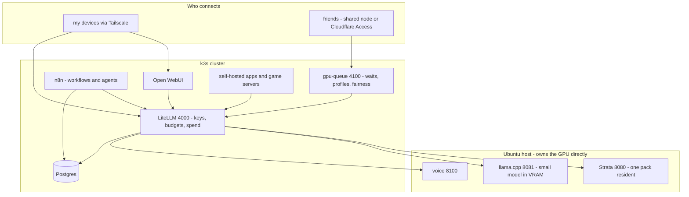

# Server architecture

How one box runs a Kubernetes cluster, an automation platform, an agent system, game servers and a desktop — on 64–96 GB of RAM and a single 16 GB graphics card.

Read this before the server scripts. Every decision in [`../server/`](../server/) follows from the constraints here.

## The one thing to understand

**Kubernetes does not orchestrate AI agents.** It schedules containers onto nodes. It has no concept of an LLM call, a prompt, or a reasoning budget. When you ask for "an AI system orchestrated like Kubernetes with brains, workers and validators", Kubernetes is the wrong layer for all of it except hosting the processes.

Worse, it actively fights you here. The NVIDIA device plugin advertises `nvidia.com/gpu: 1` and assigns **the whole card to one pod**. Three agent roles as three GPU pods means two of them sit `Pending` forever. Time-slicing exists, but it interleaves kernels without partitioning VRAM, so two models that each want 12 GB still will not fit.

The split that works:

| Layer | What runs there | Why |
|---|---|---|
| **Host** | Strata, llama.cpp, voice | Owns the GPU outright. `mlock`s 25–30 GB. Needs raised memlock limits. Takes 1–3 minutes to load. |
| **k3s** | LiteLLM, n8n, Postgres, Open WebUI, apps, game servers | Light, restartable, benefits from declarative config and ingress |
| **LiteLLM** | Routing, keys, budgets, spend | The thing that actually "orchestrates" model access |
| **n8n + Postgres** | Agent topology, workflow state, prompt store | Where brains, workers and validators live — as prompts, not pods |



### Why the models stay out of the cluster

Containerising Strata on a single node buys you nothing and costs you several things:

- It needs `--ulimit memlock=-1` and privileged access to pin 25–30 GB
- It needs the whole GPU, so the device plugin gives it a permanent claim and nothing else can ever schedule against the card
- A pod restart means a 1–3 minute reload during which everything that depends on it fails
- The model files are 677 GB on the host filesystem; mounting them in is pure indirection

Pods reach the host services through a Service with manually defined Endpoints pointing at the host's cluster IP. That is covered in [kubernetes.md](kubernetes.md).

## The RAM budget

This is the real design constraint, and the arithmetic is worth internalising.

| Component | Resident |
|---|---:|
| Ubuntu, desktop session, kernel | ~3 GB |
| k3s server + agent + CoreDNS + Traefik | ~1.5 GB |
| Postgres | ~2 GB |
| n8n | ~1 GB |
| LiteLLM | ~0.5 GB |
| Open WebUI | ~1 GB |
| Argo CD *(phase 20, optional)* | ~1 GB |
| GPU queue *(phase 21, optional)* | ~0.3 GB |
| One game server (Minecraft or Valheim) | ~4 GB |
| Headroom for page cache and bursts | ~2 GB |
| **Server stack subtotal** | **~16.3 GB** |

Strata's fit rule is experts plus ~10 GB for the operating system, so that subtotal sets the ceiling directly:

| | Reported | Less the stack | **Experts, cluster up** | **Experts, paused** |
|---|---:|---:|---:|---:|
| 96 GB | ~93 GiB | ~77 GB | **~67 GB** | ~83 GB |
| 64 GB | ~62 GiB | ~46 GB | **~36 GB** | ~52 GB |

Which of those two rows applies depends on how phase 11 was fitted — see [ram-upgrade-decision.md](ram-upgrade-decision.md).

| Pack | Experts | 96 GB, cluster up | 64 GB, cluster up | After `ai-pause` |
|---|---:|---|---|---|
| Coder | 23 GB | yes | yes | yes |
| Q2_0 | 34 GB | yes | yes | yes |
| **IQ2_XS** | 35.5 GB | yes | **yes — the daily driver at 64 GB** | yes |
| IQ3_XXS | 43 GB | yes | no | yes |
| **IQ3_S** | 50 GB | **yes — the daily driver at 96 GB** | no | yes |
| UD-IQ4_XS | 62 GB | yes, 6 GB margin | no | yes |
| NVFP4 | 70 GB | no | no | yes, at 96 GB only |

At 64 GB, IQ2_XS being both the ceiling here and Strata's own recommended default is a genuine coincidence, and a lucky one. At 96 GB the coincidence stops mattering, because the server stack is no longer what decides your model.

**Phases 20 and 21 narrow that coincidence at 64 GB.** Argo CD and the queue add about 1.3 GB between them, which takes the experts budget from ~37 GB to ~36 GB against IQ2_XS at 35.5 GB. It still fits, but the margin goes from comfortable to roughly half a gigabyte, and that is thin enough that a page-cache burst can be felt.

Two things make it a non-issue in practice. Both namespaces are labelled `ai-workstation/pausable`, so `ai-pause` reclaims all of it. And neither phase is required — the platform runs without either, and at 96 GB the arithmetic does not change anything you would notice. If you are at 64 GB and want IQ2_XS resident all day, run phase 21 and skip phase 20: the queue is the one that earns its memory continuously, while Argo CD only matters when you are deploying.

### `ai-pause` and `ai-resume`

Installed by [`../server/01-server-base.sh`](../server/01-server-base.sh).

```sh
ai-pause            # stop the cluster workloads and the model server
ai-pause --cluster  # stop k3s entirely, freeing its ~1.5 GB too
ai-resume           # bring everything back
ai-status           # what is running and what it costs
```

`ai-pause` scales the platform Deployments to zero rather than deleting them, so state in Postgres volumes survives. It is the same mechanism used before a gaming session — see [linux-gaming.md](linux-gaming.md).

If you have run phase 20 or 21, `ai-pause` does two more things. It drains the GPU queue first, so somebody mid-request gets an answer instead of a dropped connection, and it scales Argo CD down before anything else — otherwise Argo CD's self-heal would notice the replica counts drop and put everything straight back. [gitops.md](gitops.md) covers that conflict and the three mechanisms that resolve it.

## The VRAM budget

16 GB, and far less negotiable than RAM.

| Consumer | VRAM |
|---|---:|
| Desktop session (GNOME, compositor) | 1–1.5 GB |
| Strata hot experts | the rest, as much as it can get |
| llama.cpp small model (7–14B at Q4_K_M) | ~9 GB if co-resident |
| ComfyUI image generation | 12–15 GB |
| A game | 8–14 GB |

**Nothing in this table can share with anything else except the desktop.** The only co-residency that works is Strata plus a small llama.cpp model, and only if you accept that Strata gets ~5 GB of hot-expert space instead of ~14.

That co-residency is deliberate, because it is what gives the agent system two independent runtimes for cross-checking. See [agent-orchestration.md](agent-orchestration.md).

`ai-console-mode off` drops to a text console and reclaims the desktop's 1–1.5 GB. On a headless server you would simply never start the desktop, but this machine also games, so the toggle stays.

## The CPU budget

The one resource that is not scarce. Eight Zen 5 cores with 3D V-Cache, and the server stack is almost entirely idle-waiting. Game servers are the main consumer and they are single-thread-bound, which the 9800X3D is unusually good at.

Set `cpu-performance.service` leaves the governor at `performance`, which matters for latency-sensitive inference and for game-server tick rates.

## What always-on actually requires

The original kit assumed a workstation you log into. Several things break when nobody is logged in:

| Was | Now | Why |
|---|---|---|
| `voice-server` user unit | **system** unit | User units stop at logout |
| `open-webui` user unit | moved into k3s | Same, plus it belongs with the platform |
| `ai-console-mode` as the normal state | optional | A server has no desktop to shed |
| Sleep and suspend enabled | **disabled** | Suspend kills Tailscale and every connection |
| Interactive `confirm()` prompts | `--yes` paths everywhere | Nobody is at the keyboard |

`loginctl enable-linger` is set for the primary user so anything still running as a user service survives logout. [`../server/01-server-base.sh`](../server/01-server-base.sh) handles all of it.

## Dual boot is a planned outage

Booting Windows takes the entire platform down: cluster, automations, friends' access, game servers. There is no clustering, no failover and no second node.

This is accepted rather than solved. The mitigation is [linux-gaming.md](linux-gaming.md) — if Proton covers your library, Windows becomes a once-a-month boot instead of a daily one. Check your titles before relying on that; kernel anti-cheat blocks several large multiplayer games outright.

Set Ubuntu as the default in BIOS under Boot > Boot Option Priorities, so an unattended power-loss recovery comes back as the server rather than sitting at a Windows login.

## Data retention, so the disk does not fill silently

Three things grow without bound by default:

| Data | Grows via | Bound it with |
|---|---|---|
| n8n execution history | every workflow run | `EXECUTIONS_DATA_MAX_AGE=336` (14 days) |
| LiteLLM request logs | every API call | Postgres retention job, 30 days |
| k3s container images | every image pull and upgrade | `k3s crictl rmi --prune`, monthly |

All three are configured by the server scripts. On the 2 TB drive this is worth taking seriously rather than filing under hygiene: the platform shares its space with model packs and a Steam library, so an unbounded Postgres table competes with things you would rather keep.

## Backup

The cluster is reproducible from the manifests in [`../server/k8s/`](../server/k8s/). The data is not, so [`../server/07-backup.sh`](../server/07-backup.sh) installs a nightly job covering:

- **Postgres** — `pg_dumpall`, which captures roles as well as data
- **n8n workflows** — exported as JSON alongside, so they survive a Postgres loss
- **Secrets** — `/srv/platform/secrets`, the smallest and least replaceable thing here
- **Game worlds** — `/srv/games`, with Minecraft writes flushed and held during the copy
- **Model files** — not backed up. They are 677 GB and re-downloadable.

Two layers, because they fail differently. `/srv/backups` is on the same drive and protects against mistakes; an encrypted restic repository offsite protects against the drive, the building and ransomware. Everything irreplaceable here totals a few GB, so offsite runs about 50 kr a month.

**A NAS does not solve this.** RAID covers a disk failing and nothing else — not fire, theft, a bad migration or a dropped table — and a second box in the same room shares every risk that actually destroys data. Capacity is not the question either: the protected set is under 10 GB, and the large things on this drive are re-downloadable.

The detail that decides whether any of it works: the restic password and `n8n-encryption-key` must be recorded somewhere that is **not this machine**, or the backups are ciphertext you cannot read. Full reasoning and a restore walkthrough in [backups.md](backups.md).
